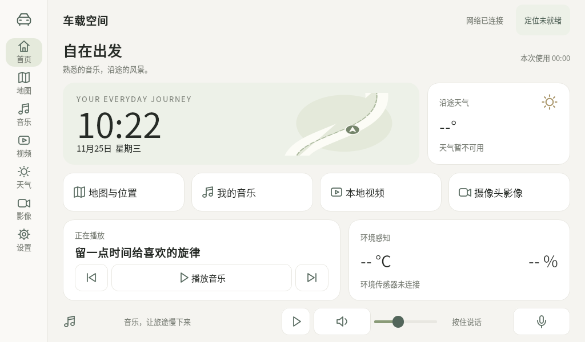
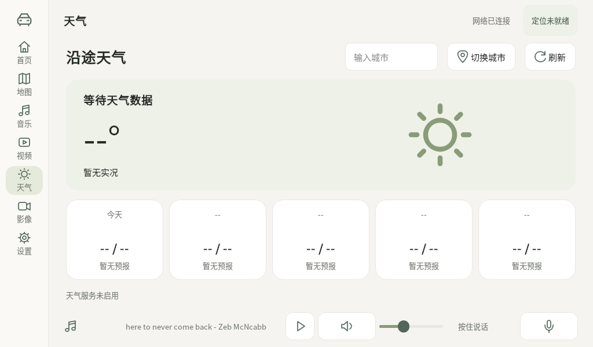

<h1 align="center">Linux In-Vehicle Terminal</h1>

<p align="center">
  基于 <strong>NXP i.MX6ULL</strong> 与 <strong>Qt Widgets</strong> 的嵌入式车载交互终端。<br>
  在 1024 × 600 触摸屏上集成本地媒体、地图定位、天气、摄像头与设备管理。
</p>

<p align="center">
  <a href="#硬件平台"></a>
  <a href="#构建"></a>
  <a href="#部署与运行"></a>
  <a href="LICENSE"></a>
</p>

<p align="center">
  <strong><a href="#功能">功能</a> · <a href="#硬件平台">硬件</a> · <a href="#构建">构建</a> · <a href="#配置">配置</a> · <a href="#测试">测试</a></strong><br>
  简体中文 · <a href="README_EN.md">English</a>
</p>



## 功能

| 模块 | 功能 |
| --- | --- |
| 🏠 首页 | 时间与日期、网络和定位状态、环境数据、快捷入口、音乐控制与本次使用时长。 |
| 🎵 音乐 | 本地及 SD 卡扫描、收藏、循环与随机播放、进度调节、播放位置记忆、在线搜索与独立下载任务。 |
| 🎬 视频 | 本地视频列表、上一条与下一条、进度和音量控制；离开页面自动暂停。 |
| 🗺️ 地图 | 地点查询、GNSS 位置显示、静态地图缩放和地点收藏。使用 WGS84 坐标请求地图。 |
| ☀️ 天气 | 城市切换、多日预报、手动与定时刷新、网络异常提示。 |
| 📷 影像 | V4L2 实时摄像头、帧率、AP3216C 接近度原始值；离开页面停止采集。 |
| 🎙️ 语音 | 按住录音、松开识别；支持媒体、地图、天气、影像与页面切换指令。 |
| ⚙️ 设置 | ConnMan Wi-Fi、夜间及大字模式、音量、可用设备的背光控制、GNSS、内存与存储、日期和校时。 |

所有页面位于同一主窗口中，按需创建。界面采用暖白与灰绿色，并提供持久化显示偏好。
设备未连接、未获得定位或在线服务不可用时，界面显示对应状态。
地图为静态位置展示，不提供路线规划或逐向导航；接近度读数不等同于经过标定的距离。

<p>
  
  
</p>
<p>
  
  
</p>

截图由应用的 `--screenshots` 模式生成。未连接开发板和未配置在线服务时，截图保留实际不可用状态。

## 硬件平台

| 部件 | 项目配置 |
| --- | --- |
| 处理器 | NXP i.MX6ULL，Arm Cortex-A7。 |
| 显示与触摸 | 1024 × 600，Linux framebuffer；触摸输入由板级 Qt/evdev 配置提供。 |
| 内存 | 原工程目标为 512 MB，实际可用量取决于 BSP 与后台服务。 |
| 摄像头 | Linux V4L2，默认 `/dev/video1`，请求 640 × 480 RGB565。 |
| GNSS | UART NMEA GGA/RMC，默认 `/dev/ttymxc2`、9600 波特率；校验校验和及坐标边界。 |
| 温湿度 | DHT11 字符设备，默认 `/dev/dht11`。 |
| 环境光 / 接近度 | AP3216C sysfs，默认 `/sys/class/misc/ap3216c`。 |
| 音频与按键 | ALSA 音频输入输出；可选 `/dev/key` 录音按键。 |
| 网络 | Wi-Fi 设备与 ConnMan、系统 D-Bus。 |

设备节点取决于开发板镜像，均可通过配置覆盖。驱动、设备树和内核镜像由开发板 BSP 提供。

## 构建

使用 **Qt 5.15** 和 C++11。依赖 Qt Core、Gui、Widgets、Network、Concurrent、Multimedia、MultimediaWidgets、DBus；测试额外依赖 Qt Test。
目标镜像需要 Qt 平台插件、字体、媒体后端及编解码器、与 Qt 匹配的 TLS 库和 CA 证书。虚拟键盘为可选组件。

```sh
git clone https://github.com/lewuq/Linux-in-vehicle-project.git
cd Linux-in-vehicle-project
mkdir build && cd build
/path/to/target-qt/bin/qmake ../VehicleTerminal.pro
make -j2
```

交叉编译使用开发板 SDK 中的目标 Qt `qmake`，并先加载 SDK 环境。宿主 Qt 的 `qmake` 只能生成宿主程序。
当前多媒体实现使用 Qt 5 API，不能直接以 Qt 6 编译。

桌面预览：

```sh
VEHICLE_HARDWARE_ENABLED=false ./VehicleTerminal --windowed
```

## 配置

复制 [`vehicle.ini.example`](vehicle.ini.example) 为可执行文件旁的 `vehicle.ini`，或以 `VEHICLE_CONFIG` 指定路径。
真实凭据文件已在 `.gitignore` 中排除。

| 配置项 | 用途 |
| --- | --- |
| `paths/music`、`paths/video` | 媒体目录，多个目录用分号分隔；同时扫描应用媒体目录与常见 SD 卡目录。 |
| `paths/data` | 可写数据目录，用于下载歌曲、录音。默认采用 Qt 应用数据目录。 |
| `hardware/*` | 设备节点、串口波特率与硬件启用状态。ARM Linux 默认启用硬件访问，桌面默认关闭。 |
| `map/api_key` | 百度静态地图服务端 AK。 |
| `weather/app_id`、`weather/app_secret` | 天气服务凭据，当前对接一天天气周预报。 |
| `speech/token` | 百度语音识别访问令牌。令牌到期后需要更新，应用不负责签发。 |

配置支持环境变量覆盖：将配置项转换为大写，`/` 替换为 `_`，并加上 `VEHICLE_` 前缀。
例如 `map/api_key` 对应 `VEHICLE_MAP_API_KEY`。用户收藏、播放进度和显示偏好由 `QSettings` 单独保存。

在线功能需要对应服务的有效凭据、网络与配额。所有请求使用 HTTPS 和正常证书校验。
音乐结果与下载权限取决于第三方服务；下载完成前不会覆盖现有媒体文件。

## 部署与运行

将目标二进制、`vehicle.ini`、`scripts/` 及所需 Qt 运行库部署至 `/opt/vehicle-terminal`。
项目字体、图标和样式已嵌入二进制，不需要部署源码资源目录。

```sh
cd /opt/vehicle-terminal
QT_QPA_PLATFORM=linuxfb sh scripts/run.sh
```

按镜像配置 framebuffer、触摸输入、音频、D-Bus 和设备权限。若使用虚拟键盘，需要安装匹配的 Qt Virtual Keyboard 插件。
可设置 `QT_IM_MODULE=qtvirtualkeyboard` 启用，或将该变量设为空禁用。
系统时区默认为 `Asia/Shanghai`，镜像需提供相应时区数据。修改系统时间与写入 RTC 需要对应权限。

使用 systemd 的镜像可安装 [`deploy/vehicle-terminal.service`](deploy/vehicle-terminal.service)。
环境变量可放入 `/etc/vehicle-terminal.env`；服务默认不随源码安装或自动启用。

## 工程结构

```text
Core/          配置、异步服务、媒体扫描、下载和数据模型
Ui/            共享主题、线性图标与界面组件
Map/           有界 NMEA 解析、串口采集与地图页
Monitor/       V4L2 采集、AP3216C 与影像页
Music/         音乐播放与搜索页
Weather/       天气页与图标
tests/         Qt Test 回归测试
scripts/       设备启动脚本
deploy/        systemd 服务示例
docs/          本地徽章、实际界面截图
```

## 测试

```sh
mkdir build-tests && cd build-tests
qmake ../tests/tests.pro
make -j2
QT_QPA_PLATFORM=offscreen ./vehicle-tests
```

测试覆盖 GPS 坐标转换及异常帧、短天气预报与异常数据、语音指令优先级、下载任务隔离及错误内容拒绝、命令启动失败、媒体去重、页面懒加载和切换。

```sh
VEHICLE_HARDWARE_ENABLED=false QT_QPA_PLATFORM=offscreen \
  ./VehicleTerminal --windowed --screenshots ./screenshots
```

桌面测试不替代开发板验证。上板需检查摄像头格式、重复启停、音视频编解码、触摸、Wi-Fi 认证、GNSS、传感器、校时权限和长期内存占用。

## 许可

项目原创代码与文档使用 [MIT License](LICENSE)。第三方字体、库、示例代码和媒体保留各自许可与版权，见 [第三方声明](THIRD_PARTY_NOTICES.md)。
Noto Sans CJK 字体使用 [SIL Open Font License 1.1](Fonts/OFL.txt)。
