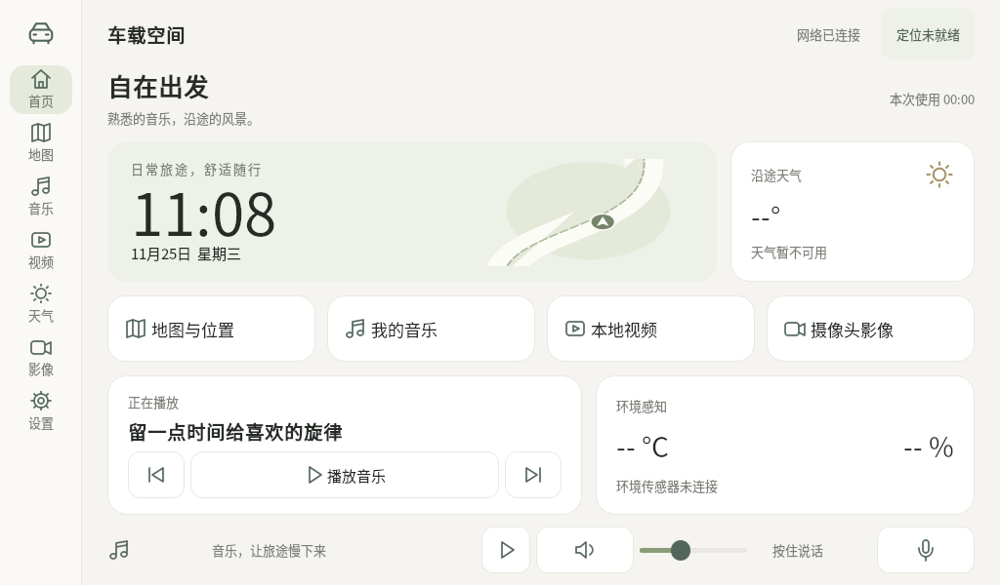

<h1 align="center">Linux In-Vehicle Terminal</h1>

<p align="center">
  An embedded infotainment interface for <strong>NXP i.MX6ULL</strong>, built with <strong>Qt Widgets</strong>.<br>
  Local media, positioning, weather, camera and device controls on a 1024 × 600 touch display.
</p>
<p align="center">
  
  
  
  <a href="LICENSE"></a>
</p>
<p align="center"><a href="README.md">简体中文</a> · English</p>



## Features

- One native window, persistent navigation and pages created on demand.
- Live Simplified Chinese / English switching in Settings. Chinese is the first-run default; language preference is saved without recreating pages or interrupting playback.
- Local/SD music, favorites, playback modes, seeking, playback memory and isolated streaming downloads.
- Local video with playback/volume controls and automatic pause when leaving the page.
- GNSS GGA/RMC parsing, checksum validation, WGS84 map requests and saved locations.
- City selection and multi-day weather with asynchronous refresh and error states.
- V4L2 camera capture with frame backpressure, FPS and raw AP3216C proximity readings.
- Hold-to-talk speech commands, ConnMan Wi-Fi, night/large-text modes, backlight where available, device status and clock controls.

Unavailable hardware and services are shown explicitly. Maps display static positions; they do not provide turn-by-turn navigation.
Proximity readings are raw sensor values, not calibrated distances. Screenshots are produced by the actual application in hardware-off mode.

## Hardware

The target is an i.MX6ULL ARM Cortex-A7 board with a 1024 × 600 framebuffer touch display and the original 512 MB RAM target.
Optional peripherals include a V4L2 RGB565 camera (`/dev/video1`, requested 640 × 480), UART GNSS (`/dev/ttymxc2`, 9600 baud),
DHT11 (`/dev/dht11`), AP3216C (`/sys/class/misc/ap3216c`), ALSA audio, a recording key (`/dev/key`) and Wi-Fi with ConnMan/system D-Bus.
Device nodes are configurable. Kernel drivers and device trees come from the board BSP.

## Build

Use Qt 5.15 and C++11 with Core, Gui, Widgets, Network, Concurrent, Multimedia, MultimediaWidgets and DBus. Tests also require Qt Test.
The target needs platform plugins, a multimedia backend/codecs, compatible TLS libraries and CA certificates.
Qt Virtual Keyboard is optional. Qt 6 Multimedia is not source-compatible with this application.

```sh
git clone https://github.com/lewuq/Linux-in-vehicle-project.git
cd Linux-in-vehicle-project
mkdir build && cd build
/path/to/target-qt/bin/qmake ../VehicleTerminal.pro
make -j2
```

For cross-compilation, source the BSP SDK environment and use its target Qt `qmake`.
For desktop preview, use a host Qt build and run `VEHICLE_HARDWARE_ENABLED=false ./VehicleTerminal --windowed`.

## Configuration and deployment

Copy [`vehicle.ini.example`](vehicle.ini.example) to `vehicle.ini` beside the executable, or set `VEHICLE_CONFIG`.
Configure media/data paths, hardware nodes, the Baidu static-map server AK, weather app ID/secret and speech access token.
Environment overrides use `VEHICLE_` plus the uppercase key with `/` replaced by `_`, e.g. `VEHICLE_MAP_API_KEY`.
Credentials are not bundled. Third-party availability and media download permissions depend on their respective services.
User display preferences, music favorites and playback position are stored separately using `QSettings`.

Deploy the target binary, configuration and `scripts/` to `/opt/vehicle-terminal`, together with the required Qt runtime.
Fonts, icons and styles are embedded. Configure framebuffer, touch, audio, ConnMan/D-Bus and device permissions for the BSP.

```sh
cd /opt/vehicle-terminal
QT_QPA_PLATFORM=linuxfb sh scripts/run.sh
```

The launch script defaults to `Asia/Shanghai`; the image must provide its timezone data.
Clock changes and RTC writes require appropriate permissions. Install Qt Virtual Keyboard before enabling `QT_IM_MODULE=qtvirtualkeyboard`;
an explicitly empty `QT_IM_MODULE` disables it. An optional [systemd unit](deploy/vehicle-terminal.service) is provided.

## Project structure

`Core/` contains services and models; `Ui/` holds the shared theme and icons. `Map/`, `Monitor/`, `Music/` and `Weather/` contain the feature pages.
`Translations/` contains the interface translation catalog.
`tests/` holds regression tests, `scripts/` and `deploy/` provide deployment examples, and `docs/` contains badges and screenshots.

## Tests

```sh
mkdir build-tests && cd build-tests
qmake ../tests/tests.pro
make -j2
QT_QPA_PLATFORM=offscreen ./vehicle-tests
```

Tests cover GPS parsing, malformed weather, command matching, out-of-order downloads, invalid download bodies,
failed process starts, deduplicated scanning, lazy page creation and navigation.
Capture application pages with `QT_QPA_PLATFORM=offscreen ./VehicleTerminal --windowed --screenshots ./screenshots`.
Desktop checks do not replace target-board validation of drivers, codecs, touch input, authentication, repeated capture start/stop and memory use.

## License

Original project code and documentation are under the [MIT License](LICENSE).
Third-party code, libraries and media retain their respective rights; see [THIRD_PARTY_NOTICES.md](THIRD_PARTY_NOTICES.md).
The bundled Noto Sans CJK font is under [SIL OFL 1.1](Fonts/OFL.txt).
